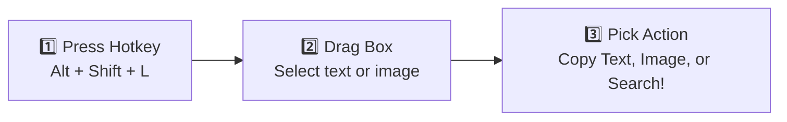

<div align="center">

# 👁️ Sharingan Lens
### Visual Search, Screen Snipping & OCR Text Extraction for Every Browser

[](https://developer.chrome.com/docs/extensions/mv3/intro/)
[](https://github.com)
[](LICENSE)
[](https://github.com)

<p align="center">
  <b>Brings Google Lens-style powers to every browser with your default search engine, instant text copying, and high-res image snipping — all in a sleek crimson-and-black anime theme.</b>
</p>

[Quick Start](#-how-to-use-in-3-simple-steps) •
[Installation Guide](#-installation-guide-by-browser) •
[Buttons Explained](#-the-action-bar-explained) •
[Shortcuts](#-keyboard-shortcuts)

---

</div>

## 🌟 What is Sharingan Lens?

**Sharingan Lens** is an open-source browser extension. Normally, Google Lens is locked inside Google Chrome and forces you to use Google Search. 

**Sharingan Lens frees you from that lock-in:**
* 🎯 **Select any area on any website** with a crisp, zero-blur snipping box.
* 📝 **Copy Text straight to your clipboard** (no annoying tabs opening).
* 🖼️ **Copy cropped images as PNG** so you can immediately paste (`Ctrl+V`) into Discord, Slack, WhatsApp, or Word.
* 🔍 **Search using your favorite search engine** (Brave Search, DuckDuckGo, Bing, or Google) in a new tab.
* 🌐 **Runs on EVERY browser**: Brave, Firefox, Chrome, Edge, Opera, Vivaldi, Arc, and Safari.

---

## 🎮 How to Use in 3 Simple Steps



```
   Step 1: Activate                    Step 2: Snip Any Area                 Step 3: Click Action
 ┌──────────────────────┐             ┌───────────────────────────────┐     ┌───────────────────────────────────────────────┐
 │ Press Alt+Shift+L   │    ──────>  │ Drag mouse to draw a box      │ ──> │ [🔍 Search (New Tab)]  [📝 Copy Text] [🖼️ Copy]│
 │ (or click eye icon)  │             │ over any text or photo        │     └───────────────────────────────────────────────┘
 └──────────────────────┘             └───────────────────────────────┘
```

---

## 🎛️ The Action Bar Explained

Whenever you drag a box on your screen, this floating action bar appears:

```
┌─────────────────────────────────────────────────────────────────────────────┐
│  [🔍 Search (New Tab)]    [📝 Copy Text]    [🖼️ Copy Image]   [🌐 Lens Visual] │
└─────────────────────────────────────────────────────────────────────────────┘
```

| Button | What It Does (In Simple Words) |
| :--- | :--- |
| **📝 Copy Text** | **Strictly copies text to your clipboard.** Reads all letters, numbers, and paragraphs inside the box and copies them. Shows a green checkmark and closes. **Never opens any new tab.** |
| **🖼️ Copy Image** | **Copies the cropped picture to your clipboard.** Press <kbd>Ctrl</kbd> + <kbd>V</kbd> to paste it into chat apps, notes, or documents. Sharp, crystal-clear, zero blur. |
| **🔍 Search (New Tab)** | **Searches your browser's default search engine.** If you use Brave Search, it searches Brave. If you use DuckDuckGo, it searches DuckDuckGo. Opens cleanly in a new tab. |
| **🌐 Lens Visual** | **Reverse image search.** Searches the internet to find where the cropped picture came from or find similar photos. |

---

## 🚀 Installation Guide (By Browser)

All pre-built folders and ready-to-use `.zip` packages are located in the [`dist/`](dist/) folder.

### 🦁 1. Brave Browser
1. In your address bar, go to: `brave://extensions`
2. Turn **ON** the **Developer mode** switch in the top-right corner:
   ```
   [Developer mode  ⚪ -> 🔘]
   ```
3. Click the **"Load unpacked"** button in the top-left.
4. Select the folder:
   ```
   Project/dist/brave
   ```
   *(Or drag & drop `dist/sharingan-lens-brave.zip` directly onto the page!)*

---

### 🌐 2. Google Chrome
1. In your address bar, go to: `chrome://extensions`
2. Turn **ON** **Developer mode** (top-right toggle).
3. Click **"Load unpacked"**.
4. Select the folder:
   ```
   Project/dist/chrome
   ```

---

### 🦊 3. Mozilla Firefox *(Also Zen, Floorp, LibreWolf)*
1. In your address bar, go to: `about:debugging#/runtime/this-firefox`
2. Click the **"Load Temporary Add-on..."** button.
3. Select the file:
   ```
   Project/dist/firefox/manifest.json
   ```
   *(Or choose `dist/sharingan-lens-firefox.zip`)*
4. That's it! To update later, just click **"Reload"**.

---

### 🌊 4. Microsoft Edge
1. In your address bar, go to: `edge://extensions`
2. Turn **ON** **Developer mode** in the left sidebar menu.
3. Click **"Load unpacked"** and select:
   ```
   Project/dist/edge
   ```

---

### 🔴 5. Opera / Vivaldi / Arc
1. Open your browser extension manager:
   * **Opera:** `opera://extensions`
   * **Vivaldi:** `vivaldi://extensions`
   * **Arc:** `arc://extensions`
2. Enable **Developer mode**.
3. Click **"Load unpacked"** and select:
   ```
   Project/dist/chromium
   ```

---

### 🧭 6. Apple Safari (macOS)
1. Safari WebExtension files are pre-built in `dist/safari/` and `dist/sharingan-lens-safari.zip`.
2. Convert with Apple's Xcode extension tool:
   ```bash
   xcrun safari-web-extension-converter dist/safari
   ```
3. In Safari: Enable **Develop Menu** -> Check **"Allow Unsigned Extensions"**.

---

## ⌨️ Keyboard Shortcuts

| Shortcut | Action |
| :--- | :--- |
| <kbd>Alt</kbd> + <kbd>Shift</kbd> + <kbd>L</kbd> | **Start Snipping:** Open the Sharingan eye selection overlay |
| <kbd>Enter</kbd> | **Quick Search:** Instantly search whatever you selected in a new tab |
| <kbd>Esc</kbd> | **Cancel:** Exit snipping mode immediately |
| <kbd>Alt</kbd> + <kbd>Shift</kbd> + <kbd>K</kbd> | **Full Screen:** Snip and search the entire visible screen |

> *(On macOS, you can use <kbd>Option</kbd> + <kbd>Shift</kbd> + <kbd>L</kbd>)*

---

## 🎬 Bonus: Video Frame Capture

Want to search an actor, location, or product inside a playing video?
1. Right-click on any HTML5 video (e.g. on **YouTube**, **Twitch**, **X/Twitter**, **Reddit**).
2. Click **"Sharingan Lens: Reverse image search"** or **"Extract text from image (OCR)"**.
3. It captures that exact paused video frame and analyzes it!

---

## 🛠️ Building & Testing From Source

If you are a developer and want to edit or rebuild the extension:

```bash
# 1. Install dependencies
npm install

# 2. Run syntax and manifest validation tests (40+ automated checks)
npm test

# 3. Build target packages for every browser into dist/
npm run build
```

---

## 🛡️ Privacy & Security

* **🔒 100% Local Processing:** When you copy text or image, the cropping and extraction happens completely inside your browser. No data is sent to external servers.
* **🚫 Zero Ads & Zero Trackers:** No telemetry, no background analytics, no third-party scripts.
* **📖 Open Source:** Inspect all source code freely.

---

## 📄 License

Distributed under the **MIT License**. Free for personal and commercial use.
